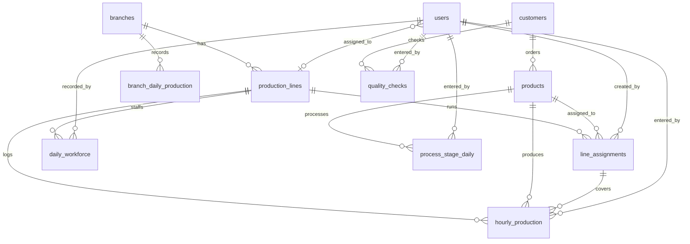

# AmirtexOS — System Documentation

> **Textile Production Line Management System**
> Full codebase reference: architecture, database, API, frontend, and file map.

**Last scanned:** 2026-11-22
**Repo root:** `textile-system/`
**Purpose:** A production management system for textile factories — hourly line production, workforce, cutting/packing/ironing stages, quality control, branches, customers/products, users, and reporting.

---

## Table of Contents

1. [Find It Fast](#1-find-it-fast)
2. [System Overview](#2-system-overview)
3. [Tech Stack](#3-tech-stack)
4. [Repository Map](#4-repository-map)
5. [Architecture & Request Flow](#5-architecture--request-flow)
6. [Database](#6-database)
7. [Backend (server/)](#7-backend-server)
8. [API Reference](#8-api-reference)
9. [Frontend (client/)](#9-frontend-client)
10. [Design System](#10-design-system)
11. [Business Flows](#11-business-flows)
12. [Environment & Setup](#12-environment--setup)
13. [Common Tasks / How to Extend](#13-common-tasks--how-to-extend)
14. [Known Issues & Gotchas](#14-known-issues--gotchas)
15. [Complete File Index](#15-complete-file-index)

---

## 1. Find It Fast

| I want to… | Go to |
|---|---|
| Change the database schema | [`ai_studio_code.sql`](ai_studio_code.sql) (full DDL) + [`server/migrations/`](server/migrations/) |
| Add/modify an API endpoint | [`server/src/routes/`](server/src/routes/) (most routes contain logic inline) |
| Change server startup / mount a route | [`server/src/index.ts`](server/src/index.ts) |
| Change DB connection | [`server/src/config/db.ts`](server/src/config/db.ts) + [`server/.env`](server/.env) |
| Change login/JWT logic | [`server/src/controllers/authController.ts`](server/src/controllers/authController.ts), [`server/src/middleware/auth.ts`](server/src/middleware/auth.ts) |
| Seed default data | [`server/src/seed.ts`](server/src/seed.ts) |
| Add a frontend page | [`client/src/pages/`](client/src/pages/) + [`client/src/App.tsx`](client/src/App.tsx) |
| Change sidebar/navigation/roles | [`client/src/layouts/MainLayout.tsx`](client/src/layouts/MainLayout.tsx) |
| Change API calls from the UI | [`client/src/api/`](client/src/api/) |
| Change the HTTP client / auth header | [`client/src/lib/client.ts`](client/src/lib/client.ts) |
| Change colors, fonts, design tokens | [`client/src/design.ts`](client/src/design.ts) — the only design source |
| See UI/UX rules and page recipes | [`FRONTEND_DESIGN_GUIDE.md`](FRONTEND_DESIGN_GUIDE.md) |
| Reuse a button/card/modal/input | [`client/src/components/ui/`](client/src/components/ui/) |
| Work on the hourly entry grid | [`client/src/components/HourlyGrid.tsx`](client/src/components/HourlyGrid.tsx) + [`client/src/pages/supervisor/HourlyEntry.tsx`](client/src/pages/supervisor/HourlyEntry.tsx) |
| Work on dashboard charts | [`client/src/pages/admin/Dashboard.tsx`](client/src/pages/admin/Dashboard.tsx) |
| See SQL reporting views | [`ai_studio_code.sql`](ai_studio_code.sql) lines ~168–286 |
| Set up the project from scratch | [`SETUP.md`](SETUP.md) |
| See build progress / task history | [`todo.md`](todo.md) |
| See UI/UX rules | [`FRONTEND_DESIGN_GUIDE.md`](FRONTEND_DESIGN_GUIDE.md) |
---

## 2. System Overview

**AmirtexOS** tracks a textile factory's production in near real time.

Core concepts:

- **Branch** — a factory site (`Main Factory`, satellites).
- **Production Line** — belongs to a branch; runs one active product at a time.
- **Customer** — the buyer.
- **Product** — a customer order/style with `order_quantity` and `daily_target`.
- **Line Assignment** — links a line to a product with a daily target and date range. A line has at most **one active assignment**; a DB trigger auto-closes the previous one.
- **Hourly Production** — per line, per date, per hour (1–12): produced qty and defects.
- **Daily Workforce** — per line, per date: workers required, present, free-text notes.
- **Process Stages** — daily Cutting / Packing / Ironing quantities per product.
- **Quality Checks** — daily pieces checked and faults per customer.
- **Branch Daily Production** — branch-level target vs produced (separate from line-level hourly data).
- **Reports** — SQL views aggregate daily/weekly/company/line/efficiency/quality data.

Two user roles:

| Role | Intended access |
|---|---|
| `ADMIN` | Everything: dashboard, lines, branches, products, customers, reports, users |
| `SUPERVISOR` | Dashboard, Hourly Entry, Cutting/Packing, Quality Control (intended) |

> **Current state:** authentication is implemented but **not enforced** on most API routes, and the UI layout currently hardcodes an ADMIN dev user. See [Known Issues](#14-known-issues--gotchas).

---

## 3. Tech Stack

### Frontend (`client/`)

| Package | Version | Use |
|---|---|---|
| React | ^19.2.6 | UI |
| React DOM | ^19.2.6 | Rendering |
| React Router DOM | ^7.18.0 | Client-side routing |
| Vite | ^8.0.12 | Dev server / build |
| TypeScript | ~6.0.2 | Types |
| Tailwind CSS | ^4.3.1 | Styling (via `@tailwindcss/vite`) |
| Axios | ^1.18.0 | HTTP client |
| Recharts | ^3.8.1 | Dashboard charts |
| Lucide React | ^1.21.0 | Icons |

Fonts: **Geist** (UI), **Newsreader** (headlines and hero figures) and **Geist Mono** (all measured values), declared once in [`client/src/design.ts`](client/src/design.ts) and injected into the document by the Vite design plugin.

### Backend (`server/`)

| Package | Version | Use |
|---|---|---|
| Express | ^5.2.1 | HTTP server |
| `pg` | ^8.22.0 | PostgreSQL pool |
| `bcrypt` | ^6.0.0 | Password hashing |
| `jsonwebtoken` | ^9.0.3 | JWT auth |
| `dotenv` | ^17.4.2 | Env loading |
| `xlsx` | ^0.18.5 | Installed but **not used** in `src/` |
| TypeScript | ^6.0.3 | Build |
| `ts-node` | ^10.9.2 | Run/seed TS directly |
| `nodemon` | ^3.1.14 | Dev auto-restart |

### Database

- **PostgreSQL ≥ 14** (schema targets standard Postgres features: `SERIAL`, `CHECK`, partial unique indexes, `plpgsql` triggers, views).

### Not present

- No test framework or test files.
- No ESLint config file (the `lint` script exists but no `eslint.config.*`).
- No ORM/migrations framework — raw SQL files applied manually.

---

## 4. Repository Map

```
textile-system/
├── ai_studio_code.sql            # Full PostgreSQL schema: tables, indexes, trigger, views
├── SETUP.md                      # Step-by-step install/run guide
├── FRONTEND_DESIGN_GUIDE.md      # Design philosophy + page recipes (no values; points to design.ts)
├── SYSTEM_DOCUMENTATION.md       # ← this file
├── todo.md                       # Build checklist (42/42 marked complete)
├── Untitled spreadsheet(1).xlsx  # Local scratch file (gitignored)
├── .gitignore
│
├── client/                       # React + Vite frontend
│   ├── .env / .env.example       # VITE_API_BASE_URL
│   ├── index.html                # #root only (fonts injected by the Vite plugin)
│   ├── vite.config.ts            # Design plugin (CSS + fonts), React/Tailwind plugins, /api proxy → :5000
│   ├── tsconfig*.json
│   └── src/
│       ├── main.tsx              # React root
│       ├── App.tsx               # Router + ToastProvider
│       ├── design.ts             # ← SINGLE SOURCE OF TRUTH: tokens, status rules, component styles, generated CSS
│       ├── index.css             # Intentionally empty stub; replaced by design.ts at build time
│       ├── api/                  # One module per backend resource (11 files)
│       ├── components/
│       │   ├── ui/               # Design system primitives
│       │   ├── production/       # ProductionBar, StatusBadge
│       │   ├── HourlyGrid.tsx    # 12-hour × lines entry grid
│       │   └── ReportTable.tsx   # Table + CSV export
│       ├── layouts/MainLayout.tsx# Sidebar + header shell
│       ├── lib/client.ts         # Axios instance + JWT interceptor
│       └── pages/
│           ├── auth/Login.tsx
│           ├── admin/            # Dashboard, Lines, Products, Customers, Branches, Reports, Users
│           └── supervisor/       # HourlyEntry, ProcessStages, Quality
│
└── server/                       # Express + TypeScript API
    ├── .env                      # PORT, PG_*, JWT_SECRET
    ├── package.json              # dev / build / start / seed scripts
    ├── tsconfig.json             # strict, CommonJS, src → dist
    ├── migrations/
    │   └── 001_add_workforce_notes.sql
    └── src/
        ├── index.ts              # App entry: middleware, /api/test-db, route mounts, listen
        ├── seed.ts               # Admin user, branches, lines, demo customer/product
        ├── config/db.ts          # pg Pool + query helper
        ├── middleware/auth.ts    # JWT Bearer verification
        ├── controllers/          # authController, productionController
        └── routes/               # 11 routers (most logic lives here)
```

---

## 5. Architecture & Request Flow

```
┌──────────────────────────┐        HTTP/JSON        ┌──────────────────────────┐
│  React SPA (Vite)        │  ───────────────────►   │  Express API (:5000)     │
│  localhost:5173          │   Authorization: Bearer │  /api/*                  │
│                          │                         │                          │
│  pages → api/*.ts        │                         │  routes → pg Pool        │
│  axios client (JWT)      │  ◄───────────────────   │  SQL / views / triggers  │
└──────────────────────────┘        JSON             └────────────┬─────────────┘
                                                                  │
                                                                  ▼
                                                     ┌──────────────────────────┐
                                                     │  PostgreSQL (textile_db) │
                                                     │  tables + views + trigger│
                                                     └──────────────────────────┘
```

**Request path (example: hourly save):**

1. `HourlyEntry.tsx` calls `logHourlyProduction()` from `client/src/api/production.ts`.
2. Axios instance (`client/src/lib/client.ts`) adds `Authorization: Bearer <token>` from `localStorage`.
3. Request hits `POST /api/production/hourly`.
4. `server/src/routes/production.ts` → `productionController.logHourlyProduction`.
5. Controller runs an `INSERT ... ON CONFLICT (line_id, production_date, hour_number) DO UPDATE`.
6. JSON `{ success: true, data: row }` returns; UI shows a toast.

**API response convention:** almost every endpoint returns `{ success: boolean, data?: ..., message?: ... }`.

**Server entry order** ([`server/src/index.ts`](server/src/index.ts)):
`express.json()` → `GET /api/test-db` → 11 routers → `app.listen(PORT || 5000)`.
No CORS middleware, no static client serving, no global error handler.

**Vite dev proxy** ([`client/vite.config.ts`](client/vite.config.ts)) forwards `/api` → `http://localhost:5000`. If `VITE_API_BASE_URL` is an absolute URL (as in `.env.example`), the browser calls port 5000 directly and the proxy is bypassed — which matters because CORS is disabled server-side.

---

## 6. Database

Schema file: [`ai_studio_code.sql`](ai_studio_code.sql). Database name used in docs: `textile_db`.

### 6.1 Entity-Relationship Diagram



### 6.2 Tables

#### `branches`
| Column | Type | Notes |
|---|---|---|
| `branch_id` | SERIAL PK | |
| `branch_name` | VARCHAR(100) | NOT NULL, UNIQUE |
| `is_main` | SMALLINT | 0/1, default 0 |
| `is_active` | SMALLINT | 0/1, default 1 (soft delete) |
| `created_at` | TIMESTAMP | default now |

#### `users`
| Column | Type | Notes |
|---|---|---|
| `user_id` | SERIAL PK | |
| `username` | VARCHAR(50) | NOT NULL, UNIQUE |
| `password_hash` | VARCHAR(255) | bcrypt hash |
| `full_name` | VARCHAR(100) | NOT NULL |
| `email` | VARCHAR(150) | nullable |
| `role` | VARCHAR(20) | `ADMIN` \| `SUPERVISOR` |
| `assigned_line_id` | INTEGER | FK → `production_lines.line_id` |
| `is_active` | SMALLINT | 0/1, default 1 |
| `created_at` | TIMESTAMP | |

#### `branch_daily_production`
Branch-wide target/actual per day. Unique on `(branch_id, production_date)`.

`record_id` PK, `branch_id` FK, `production_date` DATE, `daily_target` INT ≥ 0, `qty_produced` INT ≥ 0, `entered_by` FK users, `entered_at`.

#### `customers`
`customer_id` PK, `customer_name` (required), `contact_person`, `phone`, `email`, `address`, `is_active` (soft delete), `created_at`.

#### `products`
| Column | Type | Notes |
|---|---|---|
| `product_id` | SERIAL PK | |
| `customer_id` | INTEGER | FK → customers |
| `product_name` | VARCHAR(150) | required |
| `style_code` | VARCHAR(50) | |
| `color` | VARCHAR(50) | |
| `size` | VARCHAR(20) | |
| `order_quantity` | INTEGER | > 0 |
| `daily_target` | INTEGER | > 0 |
| `status` | VARCHAR(20) | `PENDING` \| `ACTIVE` \| `COMPLETED` \| `ON_HOLD` \| `CANCELLED` |
| `start_date`, `due_date` | DATE | |
| `created_at` | TIMESTAMP | |

Index: `ix_products_customer (customer_id)`.

#### `production_lines`
`line_id` PK, `branch_id` FK, `line_name` (UNIQUE), `status` (`ACTIVE` \| `MAINTENANCE` \| `INACTIVE`), `created_at`.

#### `line_assignments`
Links a line to a product for a period.

`assignment_id` PK, `line_id` FK, `product_id` FK, `daily_target` > 0, `start_date` NOT NULL, `end_date`, `status` (`ACTIVE` \| `COMPLETED` \| `CANCELLED`), `created_by` FK users, `created_at`.

Indexes:
- `ix_assign_line (line_id)`, `ix_assign_product (product_id)`
- **`ux_one_active_per_line`** — partial unique index on `(line_id) WHERE status = 'ACTIVE'` → at most one active assignment per line.

**Trigger `trg_close_prev_assignment`** (BEFORE INSERT on `line_assignments`):
sets any existing `ACTIVE` assignment on the same line to `COMPLETED` with `end_date = NEW.start_date - 1`. This is why the API's "assign product" call doesn't need to close the old one manually.

#### `hourly_production`
| Column | Type | Notes |
|---|---|---|
| `log_id` | SERIAL PK | |
| `assignment_id` | INTEGER | FK line_assignments |
| `line_id` | INTEGER | FK production_lines |
| `product_id` | INTEGER | FK products |
| `production_date` | DATE | |
| `hour_number` | SMALLINT | CHECK 1–12 |
| `qty_produced` | INTEGER | ≥ 0 |
| `qty_defect` | INTEGER | ≥ 0 |
| `entered_by`, `updated_by` | INTEGER | FK users |
| `entered_at`, `updated_at` | TIMESTAMP | |

Unique: `uq_hourly (line_id, production_date, hour_number)` → upsert target.
Indexes: `ix_hourly_date`, `ix_hourly_product`.

#### `daily_workforce`
`record_id` PK, `line_id` FK, `production_date`, `workers_required` ≥ 0, `workers_present` ≥ 0 (default 0), `recorded_by` FK users, `recorded_at`. Unique `(line_id, production_date)`.
Migration [`001_add_workforce_notes.sql`](server/migrations/001_add_workforce_notes.sql) adds `notes TEXT`.

#### `audit_log`
`audit_id` PK, `table_name`, `record_id`, `action`, `old_value`, `new_value`, `changed_by`, `changed_at`.
**Defined but never written to by application code.**

#### `process_stage_daily`
`record_id` PK, `stage` CHECK (`CUTTING` \| `PACKING` \| `IRONING`), `product_id` FK, `production_date`, `qty_completed` ≥ 0, `entered_by`, `entered_at`.
Unique `(stage, product_id, production_date)`. Index `ix_stage_date`.

#### `quality_checks`
`check_id` PK, `customer_id` FK, `production_date`, `pcs_checked` ≥ 0, `pcs_faults` ≥ 0, `entered_by`, `entered_at`.
Unique `(customer_id, production_date)`. Index `ix_quality_date`.

### 6.3 Reporting Views

| View | Grain | Key output |
|---|---|---|
| `vw_daily_line_summary` | date × line × product | `total_produced`, `total_defect`, `daily_target`, `pct_of_target` |
| `vw_daily_factory_total` | date | totals + `active_lines` + `efficiency_pct` (has duplicate `total_assigned_target` / `total_target`) |
| `vw_weekly_summary` | week_start × line × product | weekly produced/defect/target |
| `vw_product_progress` | product | produced to date, remaining, `pct_complete` |
| `vw_line_efficiency` | date × line | `units_per_worker` (produced ÷ workers_present) |
| `vw_branch_daily_summary` | date × branch | target, produced, `difference` |
| `vw_company_daily_total` | date | line totals **UNION ALL** branch daily totals |
| `vw_process_stage_summary` | date × stage × product | `qty_completed` + names |
| `vw_quality_summary` | date × customer | `pcs_ok`, `pass_rate_pct` |

> Views are defined in `ai_studio_code.sql` but **not recreated by migrations**. If you change a view, update the SQL file and re-apply it.

### 6.4 Migrations

| File | Change |
|---|---|
| `server/migrations/001_add_workforce_notes.sql` | `ALTER TABLE daily_workforce ADD COLUMN IF NOT EXISTS notes TEXT;` |

Migrations are applied manually with `psql -f`. There is no migration runner or tracking table.

---

## 7. Backend (server/)

### 7.1 Entry point — `server/src/index.ts`

```ts
dotenv.config();
app.use(express.json());
app.get('/api/test-db', ...);        // DB health check
app.use('/api/auth', authRoutes);
app.use('/api/production', productionRoutes);
app.use('/api/customers', customerRoutes);
app.use('/api/products', productRoutes);
app.use('/api/lines', lineRoutes);
app.use('/api/workforce', workforceRoutes);
app.use('/api/branches', branchRoutes);
app.use('/api/stages', stageRoutes);
app.use('/api/quality', qualityRoutes);
app.use('/api/reports', reportRoutes);
app.use('/api/users', userRoutes);
app.listen(process.env.PORT || 5000);
```

### 7.2 Database pool — `server/src/config/db.ts`

Creates a `pg.Pool` from `PG_USER`, `PG_HOST`, `PG_DATABASE`, `PG_PASSWORD`, `PG_PORT` (default `5432`).
Exports:
- `default pool` — used by every route/controller.
- `query(text, params)` — thin helper (`pool.query`).

Logs on connect; exits the process on idle-client errors.

### 7.3 Auth

**Login** — [`authController.ts`](server/src/controllers/authController.ts):
1. Look up user by `username`.
2. Compare password with bcrypt — **except** a legacy bypass: if `password_hash === 'hashed_pw_here'` and password is `admin123`, allow.
3. Sign JWT with `{ id, role, name }`, expires in **1 day**, secret `JWT_SECRET` (fallback `super_secret_key_change_this_later`).
4. Return `{ token, user: { id, username, name, role, line_id } }`.

**Middleware** — [`middleware/auth.ts`](server/src/middleware/auth.ts):
- Reads `Authorization: Bearer <token>`.
- 401 if missing, 403 if invalid.
- Attaches decoded payload to `req.user`.

**Usage:** only `GET /api/auth/me` actually uses `authenticateToken`. All other routers are currently public.

### 7.4 Route organization

Two patterns coexist:

1. **Controller pattern** — `routes/production.ts` delegates to `controllers/productionController.ts`; `routes/auth.ts` delegates to `controllers/authController.ts`.
2. **Inline handler pattern** — every other router contains its SQL directly in the route file. When adding features, follow the surrounding file's pattern.

Validation is manual (check required body fields, return 400). SQL is parameterized (`$1`, `$2`, …) throughout.

---

## 8. API Reference

Base URL: `http://localhost:5000/api`
Auth column: ✅ = middleware applied today; ❌ = no middleware (token ignored).
All responses are JSON with `success` plus `data` or `message`.

### 8.1 Health & Auth

| Method | Path | Auth | Body / Query | Returns |
|---|---|---|---|---|
| GET | `/test-db` | ❌ | — | `{ success, message, time }` |
| POST | `/auth/login` | ❌ | `{ username, password }` | `{ success, token, user }` |
| GET | `/auth/me` | ✅ | — | `{ success, user: { id, role, name } }` |

### 8.2 Production

| Method | Path | Auth | Body / Query | Notes |
|---|---|---|---|---|
| POST | `/production/hourly` | ❌ | `assignment_id, line_id, product_id, production_date, hour_number, qty_produced, qty_defect, user_id?` | Upsert on `(line_id, date, hour)` |
| GET | `/production/hourly` | ❌ | `?date=YYYY-MM-DD` (required) | `log_id, line_id, hour_number, qty_produced, qty_defect` |
| GET | `/production/daily-report` | ❌ | `?date=` optional | From `vw_company_daily_total`; no date → latest 30 days |

### 8.3 Customers

| Method | Path | Body / Query |
|---|---|---|
| GET | `/customers` | `?all=true` includes inactive |
| GET | `/customers/:id` | — |
| POST | `/customers` | `{ customer_name*, contact_person?, phone?, email?, address? }` |
| PUT | `/customers/:id` | Any of the above + `is_active` (COALESCE partial update) |
| DELETE | `/customers/:id` | Soft delete (`is_active = 0`) |

### 8.4 Products

| Method | Path | Body / Query |
|---|---|---|
| GET | `/products` | `?customer_id=&status=` |
| GET | `/products/customer/:customerId` | All products for one customer |
| GET | `/products/:id` | — |
| GET | `/products/:id/progress` | From `vw_product_progress` |
| POST | `/products` | `{ customer_id*, product_name*, order_quantity*, daily_target*, style_code?, color?, size?, status?, start_date?, due_date? }` |
| PUT | `/products/:id` | Partial update (customer_id is not editable) |
| DELETE | `/products/:id` | Sets `status = 'CANCELLED'` (no hard delete) |

### 8.5 Lines & Assignments

| Method | Path | Body / Query | Notes |
|---|---|---|---|
| GET | `/lines` | `?branch_id=&status=` | Joins branch; sorts by numeric part of line name |
| GET | `/lines/:id` | — | |
| POST | `/lines` | `{ branch_id*, line_name*, status? }` | |
| PUT | `/lines/:id` | `{ branch_id?, line_name?, status? }` | |
| POST | `/lines/:id/assign` | `{ product_id*, daily_target*, start_date*, created_by? }` | Transaction; DB trigger closes previous assignment; sets product PENDING→ACTIVE |
| GET | `/lines/:id/current` | — | Active assignment + product + customer; 404 if none |
| GET | `/lines/:id/history` | — | All assignments for the line |

### 8.6 Workforce

| Method | Path | Body / Query |
|---|---|---|
| POST | `/workforce` | `{ line_id*, production_date*, workers_present*, workers_required?, notes?, recorded_by? }` — upsert |
| GET | `/workforce` | `?line_id=&date=` or `?line_id=&from=&to=` |

### 8.7 Branches

| Method | Path | Body / Query | Notes |
|---|---|---|---|
| GET | `/branches` | `?all=true` | |
| GET | `/branches/:id` | — | |
| POST | `/branches` | `{ branch_name*, is_main? }` | |
| PUT | `/branches/:id` | `{ branch_name?, is_main?, is_active? }` | |
| DELETE | `/branches/:id` | — | Soft delete |
| POST | `/branches/:id/daily` | `{ production_date*, daily_target?, qty_produced?, entered_by? }` | Upsert branch daily |
| GET | `/branches/:id/daily` | `?date=` or `?from=&to=` | |
| GET | `/branches/:id/summary` | `?date=` optional | From `vw_branch_daily_summary` |

### 8.8 Process Stages

| Method | Path | Body / Query |
|---|---|---|
| POST | `/stages` | `{ stage*, product_id*, production_date*, qty_completed*, entered_by? }` — `stage` is normalized to uppercase; must be `CUTTING`/`PACKING`/`IRONING`; upsert |
| GET | `/stages` | `?product_id=&stage=&date=` or `?from=&to=` |
| GET | `/stages/summary` | `?date=` or `?from=&to=` — from `vw_process_stage_summary` |

### 8.9 Quality

| Method | Path | Body / Query |
|---|---|---|
| POST | `/quality` | `{ customer_id*, production_date*, pcs_checked*, pcs_faults?, entered_by? }` — upsert |
| GET | `/quality` | `?customer_id=&date=` or `?from=&to=` — from `vw_quality_summary` (includes `pcs_ok`, `pass_rate_pct`) |

### 8.10 Reports

| Method | Path | Query | Returns |
|---|---|---|---|
| GET | `/reports/daily` | `date` (required) | `{ total, by_line[] }` |
| GET | `/reports/weekly` | `start`, `end` (required) | Weekly rows joined with line/product/customer |
| GET | `/reports/customer/:id` | — | Per-product order progress for a customer |
| GET | `/reports/line/:id` | `from`, `to` (required) | Daily line summary rows |
| GET | `/reports/efficiency` | `line_id?`, `from?`, `to?` | `vw_line_efficiency` rows |
| GET | `/reports/company` | `date?` or `from?&to?` | `vw_company_daily_total` rows |

### 8.11 Users

| Method | Path | Body / Query | Notes |
|---|---|---|---|
| GET | `/users` | `?role=&line_id=&all=true` | Active only by default; never returns `password_hash` |
| GET | `/users/:id` | — | |
| POST | `/users` | `{ username*, password*, full_name*, role*, email?, assigned_line_id? }` | `role` must be `ADMIN`/`SUPERVISOR`; bcrypt cost 10; 409 on duplicate username |
| PUT | `/users/:id` | `{ full_name?, email?, role?, assigned_line_id?, is_active? }` | Profile only |
| PUT | `/users/:id/password` | `{ password }` | Minimum 8 characters |
| DELETE | `/users/:id` | — | Soft delete |

---

## 9. Frontend (client/)

### 9.1 Bootstrap

- [`main.tsx`](client/src/main.tsx) mounts `<App />` in `#root` under `StrictMode`, imports `index.css` (which the Vite design plugin replaces with the generated theme from `design.ts`).
- [`App.tsx`](client/src/App.tsx) wraps everything in `ToastProvider` and `BrowserRouter`.

### 9.2 Routes

| Path | Component | Layout | Sidebar label |
|---|---|---|---|
| `/login` | `pages/auth/Login.tsx` | none | — |
| `/` | `pages/admin/Dashboard.tsx` | MainLayout | Dashboard |
| `/entry` | `pages/supervisor/HourlyEntry.tsx` | MainLayout | Hourly Entry |
| `/lines` | `pages/admin/Lines.tsx` | MainLayout | Production Lines |
| `/products` | `pages/admin/Products.tsx` | MainLayout | Products |
| `/customers` | `pages/admin/Customers.tsx` | MainLayout | Customers |
| `/branches` | `pages/admin/Branches.tsx` | MainLayout | Branches |
| `/reports` | `pages/admin/Reports.tsx` | MainLayout | Reports |
| `/users` | `pages/admin/Users.tsx` | MainLayout | Users |
| `/stages` | `pages/supervisor/ProcessStages.tsx` | MainLayout | Cutting / Packing |
| `/quality` | `pages/supervisor/Quality.tsx` | MainLayout | Quality Control |

No route guards exist. Unauthenticated users are not redirected, and unknown paths render a blank page (no wildcard/404 route).

### 9.3 Layout — `MainLayout.tsx`

- Fixed sidebar (`w-60` expanded / `w-14` collapsed) + sticky top header.
- Brand: **AmirtexOS** with factory icon.
- Nav items declared in `allNavItems` with an allowed-role list:
  - Both roles: Dashboard, Hourly Entry, Cutting/Packing, Quality Control.
  - `ADMIN` only: Production Lines, Branches, Products, Customers, Reports, Users.
- Page title map keyed by pathname.
- Mobile drawer with overlay; desktop collapse toggle.
- **Current limitation:** `user` is hardcoded to `{ name: 'Dev User', role: 'ADMIN' }`; the `user` value saved at login is not read. Collapse defaults off.

### 9.4 Page behavior summary

| Page | What it does | API modules used |
|---|---|---|
| **Dashboard** | Date picker; KPI cards (produced, target, efficiency, active lines); bar chart by line; hourly trend line chart; stage bars; quality pie; branch summary table; line table; quality detail table | `reports`, `lines`, `quality`, `stages`, `production`, `branches` |
| **HourlyEntry** | Loads ACTIVE lines with current assignments; 12-hour grid per line; workforce required/present/notes; Save All upserts each non-zero hour + workforce | `lines`, `production`, `workforce` |
| **ProcessStages** | Table of ACTIVE products × Cutting/Ironing/Packing; Save posts non-zero quantities | `products`, `stages` |
| **Quality** | Customer select + checked/faults inputs; live pass-rate gauge; submits daily QC | `customers`, `quality` |
| **Lines** | Table of lines with current product/target; create/edit line modal; assign-product modal (only PENDING products) | `lines`, `products`, `branches` |
| **Products** | CRUD table; status badges; cancel action; create/edit modal | `products`, `customers` |
| **Customers** | Expandable customer rows showing their products; CRUD modal; deactivate | `customers`, `products` |
| **Branches** | Date picker; per-branch daily target/produced entry + save; summary table | `branches` |
| **Reports** | Tabs: Daily / Weekly / All Companies; tables with CSV export | `reports` |
| **Users** | User table with role/line; create/edit; password reset via edit; deactivate | `users`, `lines` |
| **Login** | Username/password form; stores `token` + `user`; dev fallback on error | `auth` |

### 9.5 API client modules (`client/src/api/`)

| File | Exports |
|---|---|
| `auth.ts` | `login`, `getMe` |
| `branches.ts` | `getBranches`, `getBranchSummary`, `upsertBranchDaily` |
| `customers.ts` | `getCustomers`, `getCustomer`, `createCustomer`, `updateCustomer`, `deleteCustomer` |
| `lines.ts` | `getLines`, `getLine`, `getLineCurrent`, `assignProduct`, `createLine`, `updateLine` |
| `production.ts` | `logHourlyProduction`, `getHourlyProduction` |
| `products.ts` | `getProducts`, `getProduct`, `getProductsByCustomer`, `createProduct`, `updateProduct`, `deleteProduct` |
| `quality.ts` | `postQuality`, `getQuality` |
| `reports.ts` | `getDailyReport`, `getWeeklyReport`, `getCustomerReport`, `getLineReport`, `getEfficiencyReport`, `getCompanyReport` |
| `stages.ts` | `postStage`, `getStages`, `getStagesSummary` |
| `users.ts` | `getUsers`, `createUser`, `updateUser`, `resetPassword`, `deleteUser` |
| `workforce.ts` | `saveWorkforce`, `getWorkforce` |

Missing client wrappers (backend endpoints exist): `GET /lines/:id/history`, `GET /branches/:id/daily`, `DELETE /lines/:id` (none exists), `GET /products/:id/progress` (no wrapper).

### 9.6 HTTP client — `lib/client.ts`

```ts
axios.create({
  baseURL: import.meta.env.VITE_API_BASE_URL || '/api',
  headers: { 'Content-Type': 'application/json' },
});
```
Request interceptor adds `Authorization: Bearer <localStorage.token>`.
Response interceptor currently only re-rejects errors (no 401 redirect/cleanup).

### 9.7 Key components

- **`HourlyGrid.tsx`** — the core supervisor grid:
  - Line tabs (All Lines / per line).
  - Sticky columns: Line, Customer, Style/Model, Workers Required, Workers Present, Day Target, Hour Target, Hr 1–12, Total, Diff, Notes.
  - Hour target = `daily_target / 8` (note: 12 columns are shown).
  - Cell background: green ≥100% of hourly target, amber ≥70%, red below.
  - Keyboard navigation: arrows + Enter move between hour cells; worker-required Enter jumps to Hr 1.
  - Running total banner with % and “needs N/hr to meet target”.
- **`ReportTable.tsx`** — card + sticky-header table + CSV export; right-aligns numeric columns detected from data.
- **`ProductionBar.tsx`** — horizontal progress bar; `getStatusColor()` implements the 100/70 status rules; overflow chevron.
- **`StatusBadge.tsx`** — `Badge` wrapper for percentage status.
- **`ui/`** — Button, Input, Select, Textarea, Badge, Card, Modal, Spinner, Skeleton (+ table/card variants), Toast provider.

---

## 10. Design System

**Single source of truth: [`client/src/design.ts`](client/src/design.ts).** It holds
every colour, font, radius, shadow, status threshold, chart style and reusable
component style. Nothing else in the app may define design values.

### How it reaches the browser

1. `design.ts` exports `designCss`, a generated stylesheet containing
   `@import "tailwindcss";`, the `@theme` block (fonts, colours, radii, shadows),
   base body styles and keyframes.
2. The `amirtex-design-system` plugin in [`client/vite.config.ts`](client/vite.config.ts)
   replaces the contents of `src/index.css` with `designCss` (`enforce: 'pre'`,
   query strings stripped from the id).
3. The same plugin injects the Google Fonts preconnect and stylesheet links from
   `fonts.googleHref` into `index.html`.
4. [`client/src/index.css`](client/src/index.css) is an intentionally empty stub;
   [`client/index.html`](client/index.html) has no font links.

### Foundations exported

| Group | Exports |
|---|---|
| Palette | `colors` — canvas, paper, surface, cotton, ink, inkSoft, muted, carbon, rule, thread, steel, lime family, green family, amber family, risk family |
| Type | `fonts` — `sans` (Geist), `serif` (Newsreader), `mono` (Geist Mono), plus `googleHref` |
| Shape | `radius`, `shadows` |
| Status | `thresholds`, `tones`, `toneFor`, `statusFor`, `qualityTone` |
| Charts | `chart` — series palette, grid, axis ticks, tooltips, hero bar/cursor, bar radii |
| Components | `button`, `field`, `card`, `modal`, `badge`, `toast`, `table`, `segmented` |
| Composition | `page`, `layout`, `auth` |
| Loading | `skeleton`, `spinner` |

### Status rules

There is one implementation, in `design.ts`:

```ts
toneFor(pct, lineStatus)  // maintenance → idle → onTarget → atRisk → behind
statusFor(pct, lineStatus) // returns { label, text, dot, fill, soft, border }
qualityTone(rate)          // good / warning / behind using thresholds.quality*
```

The cut-offs are `thresholds.onTarget`, `thresholds.atRisk`,
`thresholds.qualityGood` and `thresholds.qualityWarning`. Components call these
helpers; they never compare against a literal. `ProductionBar.getStatusColor()`
and `HourlyGrid` both delegate to `statusFor`, and the dashboard uses `toneFor`
for its trend icons.

### Legacy token aliases

`designCss` maps the pre-redesign names onto the current palette so older markup
keeps rendering: `brand`/`brand-dark`/`brand-light`, `factory-night`,
`muted-steel`, `loom-green`/`loom-green-bg`, `caution-amber`/`amber-bg`,
`defect-red`/`defect-red-bg`, `greige`, `surface-raised`, `raw-cotton`, `slate`,
`cool-gray`, `linen`, `thread`. New code should use the canonical names from
`colors`.

### Typography and motion

- UI: **Geist**; headlines and hero figures: **Newsreader**; measured values:
  **Geist Mono** with tabular numerals.
- Body base is 14px; page titles and hero numbers scale up with the serif.
- Keyframes (`pulse-once`, `flash-green`, `fadeIn`, `slideUp`) live in
  `designCss`. `prefers-reduced-motion` disables animation and transitions.

For the rationale behind these choices and the per-page recipes, see
[`FRONTEND_DESIGN_GUIDE.md`](FRONTEND_DESIGN_GUIDE.md).

---

## 11. Business Flows

### 11.1 Line assignment

```
Admin opens /lines → Assign Product (lists PENDING products)
  → POST /lines/:id/assign { product_id, daily_target, start_date }
    → BEGIN
      → INSERT line_assignments
          → trigger closes any prior ACTIVE assignment (status=COMPLETED, end_date=start-1)
      → UPDATE products SET status='ACTIVE' WHERE status='PENDING'
    → COMMIT
```
One active assignment per line is additionally enforced by partial unique index.

### 11.2 Hourly production entry

```
Supervisor opens /entry (date defaults today)
  → GET /lines (filter ACTIVE) → GET /lines/:id/current for each
  → GET /production/hourly?date=... and GET /workforce?date=...
  → edits 12 hour cells + workforce fields
  → Save All:
      for each line with workforce values → POST /workforce (upsert)
      for each hour with produced>0 or defect>0 → POST /production/hourly (upsert)
  → toast "All data saved successfully"
```
Only ACTIVE lines that have a current assignment appear.

### 11.3 Process stages

`/stages` lists `GET /products?status=ACTIVE`. Save posts one request per product/stage where qty > 0 to `POST /stages`, which upserts on `(stage, product_id, date)`.

### 11.4 Quality control

`/quality` selects a customer, enters checked/faults, computes pass rate client-side, posts `POST /quality`. Reads come from `vw_quality_summary`, so pass rate/OK counts are precomputed.

### 11.5 Branch daily production

`/branches` loads branches and each branch's summary for the selected date. Entry saves via `POST /branches/:id/daily` (upsert). The summary table shows target, actual, difference.

### 11.6 Reporting

- **Daily** — factory total + per-line/product breakdown.
- **Weekly** — `vw_weekly_summary` filtered by `week_start` between start/end, enriched with line/product/customer names.
- **Company** — `vw_company_daily_total`, which combines line-level and branch-level production.
- CSV export is client-side in `ReportTable`.

---

## 12. Environment & Setup

Full instructions: [`SETUP.md`](SETUP.md). Condensed:

### Prerequisites
Node ≥ 18, npm ≥ 9, PostgreSQL ≥ 14.

### Database
```bash
psql -U postgres -c "CREATE DATABASE textile_db;"
psql -U postgres -d textile_db -f ai_studio_code.sql
psql -U postgres -d textile_db -f server/migrations/001_add_workforce_notes.sql
```

### Server
```bash
cd server
npm install
npm run seed     # admin/admin123, branches, lines, demo customer/product
npm run dev      # http://localhost:5000
```
Scripts: `dev` (nodemon), `build` (tsc → `dist/`), `start` (`node dist/index.js`), `seed` (ts-node).

`server/.env` variables:
| Variable | Default / example |
|---|---|
| `PORT` | `5000` |
| `PG_USER` | `postgres` |
| `PG_PASSWORD` | local Postgres password |
| `PG_HOST` | `localhost` |
| `PG_PORT` | `5432` |
| `PG_DATABASE` | `textile_db` |
| `JWT_SECRET` | random string (fallback hardcoded in code) |

### Client
```bash
cd client
npm install
npm run dev      # http://localhost:5173
```
`client/.env`:
```env
VITE_API_BASE_URL=http://localhost:5000/api
```
Alternative: set `VITE_API_BASE_URL=/api` to use the Vite proxy (recommended if you hit CORS).

### Default login
`admin` / `admin123`

---

## 13. Common Tasks / How to Extend

### Add a backend endpoint
1. Choose the router in `server/src/routes/` (or create one).
2. Write the handler inline (follow existing style) or add a controller.
3. Validate required fields, return 400 on failure.
4. Use parameterized SQL.
5. Return `{ success: true, data }`.
6. If it's a new router, mount it in `server/src/index.ts`.
7. Add a wrapper in `client/src/api/<resource>.ts`.

### Add a frontend page
1. Create `client/src/pages/<area>/<Page>.tsx`.
2. Add a `<Route>` in `client/src/App.tsx`.
3. Add a nav entry + page title in `client/src/layouts/MainLayout.tsx` (`allNavItems`, `pageTitles`).
4. Add an API module if needed.
5. Use `Card`, `Button`, `Input`, `Badge`, `Modal`, `useToast` from `components/ui`.

### Add a database table or column
1. For a fresh DB, edit `ai_studio_code.sql`.
2. For an existing DB, add `server/migrations/NNN_description.sql` with idempotent SQL (`IF NOT EXISTS` where possible).
3. Apply manually with `psql`.
4. Update this document's schema section and the file index.

### Change status colors / design tokens
- Everything: [`client/src/design.ts`](client/src/design.ts). Edit the palette,
  `thresholds`, `tones`, `chart` or a component preset there.
- The theme CSS and font links are regenerated automatically by the
  `amirtex-design-system` Vite plugin; do not edit `client/src/index.css` or add
  font tags to `client/index.html`.
- Consumers must call `statusFor` / `toneFor` / `qualityTone`; never re-implement
  a threshold.
- Rationale and page recipes: [`FRONTEND_DESIGN_GUIDE.md`](FRONTEND_DESIGN_GUIDE.md).

### Enforce authentication
Wrap routers with `authenticateToken` in `server/src/index.ts`, e.g.:
```ts
app.use('/api/production', authenticateToken, productionRoutes);
```
Then update the client to redirect on 401 in `lib/client.ts`.

---

## 14. Known Issues & Gotchas

### Security / auth
1. **API is effectively public.** `authenticateToken` is applied only to `GET /api/auth/me`. All CRUD, reports, and writes accept unauthenticated requests.
2. **Login dev fallback.** In `Login.tsx`, any failed login catches the error and signs in as a hardcoded `Dev User` / `ADMIN`. This bypasses the backend entirely from the UI's perspective.
3. **Legacy password bypass.** `authController.ts` accepts `admin123` whenever the stored hash equals the literal `hashed_pw_here`.
4. **JWT secret fallback** is hardcoded (`super_secret_key_change_this_later`) if `JWT_SECRET` is unset.
5. **Role UI is hardcoded.** `MainLayout` ignores the stored user and always shows ADMIN navigation.
6. **No route guards / no logout.** `/` is reachable without a token; there is no sign-out control.
7. **`entered_by` / `created_by` / `recorded_by` are taken from request bodies**, not from the verified token (TODO comments acknowledge this in several routes).
8. **Password policy inconsistency:** user creation allows any length; reset requires ≥ 8; seed password `admin123` is 6.

### CORS / networking
9. **No CORS middleware.** Commit `69cc0a3` says "disable cors and login". With `VITE_API_BASE_URL=http://localhost:5000/api`, the browser makes cross-origin calls and may be blocked. Use the Vite proxy (`VITE_API_BASE_URL=/api`) or serve client and API from one origin.
10. **No static serving of `client/dist`** by Express, despite SETUP.md mentioning it as a CORS workaround.

### Data / behavior
11. **12 hour columns vs 8-hour target.** `HourlyGrid` shows Hr 1–12, but hourly target = `daily_target / 8`; the running-total banner also assumes an 8-hour day.
12. **Cannot clear an hourly value to zero via Save All.** Rows are only submitted when `produced > 0 || defect > 0`; setting a cell back to 0 and saving leaves the old DB value.
13. **Workforce save is conditional.** A row is saved only if present/required/notes are non-zero/non-empty.
14. **`audit_log` is unused** — no writes anywhere.
15. **`xlsx` dependency is unused** in server source; CSV export is client-side.
16. **Duplicate columns in `vw_daily_factory_total`** (`total_assigned_target` and `total_target`).
17. **Weekly report boundary:** client sends `selectedDate - 7 days` to `selectedDate` and the query compares `week_start` (Monday) to those dates; the current partial week can be excluded.
18. **Reports “All Companies” tab** actually shows the company daily total, not per-company data.
19. **Dashboard makes N+1 calls** — one `getLineCurrent` per line and one `getBranchSummary` per branch on each load.
20. **Silent error swallowing** — many pages use `.catch(() => {})` or log-only catches, so failures often surface as empty tables.
21. **No loading/empty error distinction** in several tables (empty data and failed request look the same).

### Tooling
22. **No tests.**
23. **`npm run lint` will fail** — no ESLint config file exists in `client/`.
24. **Migrations are manual** — no runner, no schema version tracking.
25. **Node/TS versions are very new** (`@types/node ^26`, TypeScript 6) — ensure toolchain compatibility.
26. **`bcrypt` is a native module** — may need build tools on some machines.

---

## 15. Complete File Index

> Excludes `node_modules/`, `dist/`, `.git/`. Line counts are approximate.

### Root

| File | Lines | Purpose |
|---|---|---|
| `ai_studio_code.sql` | 286 | Full schema: 12 tables, indexes, assignment trigger, 9 views |
| `SETUP.md` | 333 | Install/run guide, API overview, troubleshooting |
| `FRONTEND_DESIGN_GUIDE.md` | 136 | Design philosophy and page recipes; points to `design.ts` for all values |
| `SYSTEM_DOCUMENTATION.md` | — | This document |
| `todo.md` | 95 | Build checklist (all phases marked complete) |
| `Untitled spreadsheet(1).xlsx` | — | Local scratch spreadsheet (gitignored) |
| `.gitignore` | 30 | Ignores deps, builds, env, logs, editor files, the xlsx |

### Server

| File | Lines | Purpose |
|---|---|---|
| `server/package.json` | 35 | Scripts + deps |
| `server/tsconfig.json` | 13 | Strict CommonJS build `src → dist` |
| `server/.env` | — | Local env (PORT, PG_*, JWT_SECRET) |
| `server/migrations/001_add_workforce_notes.sql` | 2 | Adds `daily_workforce.notes` |
| `server/src/index.ts` | 46 | Express entry, `/api/test-db`, route mounts |
| `server/src/seed.ts` | 68 | Seeds admin, branches, 3 lines, demo customer/product |
| `server/src/config/db.ts` | 28 | `pg.Pool` + `query()` helper |
| `server/src/middleware/auth.ts` | 21 | JWT Bearer verification |
| `server/src/controllers/authController.ts` | 58 | Login: lookup, bcrypt, JWT |
| `server/src/controllers/productionController.ts` | 77 | Hourly upsert, hourly fetch, daily report |
| `server/src/routes/auth.ts` | 14 | `POST /login`, `GET /me` |
| `server/src/routes/production.ts` | 15 | Hourly + daily-report routes |
| `server/src/routes/customers.ts` | 104 | Customer CRUD + soft delete |
| `server/src/routes/products.ts` | 167 | Product CRUD, by-customer, progress, cancel |
| `server/src/routes/lines.ts` | 187 | Line CRUD, assign, current, history |
| `server/src/routes/workforce.ts` | 76 | Workforce upsert + query |
| `server/src/routes/branches.ts` | 185 | Branch CRUD, daily production, summary |
| `server/src/routes/stages.ts` | 120 | Cutting/Packing/Ironing upsert, list, summary |
| `server/src/routes/quality.ts` | 72 | Quality upsert + view query |
| `server/src/routes/reports.ts` | 165 | Daily, weekly, customer, line, efficiency, company |
| `server/src/routes/users.ts` | 160 | User CRUD, password reset, soft delete |

### Client

| File | Lines | Purpose |
|---|---|---|
| `client/package.json` | 36 | Scripts + deps |
| `client/vite.config.ts` | 57 | `amirtex-design-system` plugin (injects design CSS + fonts), React/Tailwind plugins, `/api` proxy to :5000 |
| `client/index.html` | 13 | Root div + title (fonts injected by the design plugin) |
| `client/.env.example` | 1 | `VITE_API_BASE_URL` |
| `client/tsconfig.json` / `tsconfig.app.json` / `tsconfig.node.json` | — | TS project configs |
| `client/src/main.tsx` | 10 | React root |
| `client/src/App.tsx` | 40 | Router + all routes + ToastProvider |
| `client/src/design.ts` | 464 | ← Single source of truth: palette, type, thresholds, tones, chart, component presets, generated CSS |
| `client/src/index.css` | 7 | Intentionally empty stub; replaced at build time by `design.ts` |
| `client/src/lib/client.ts` | 26 | Axios instance + token interceptor |
| `client/src/layouts/MainLayout.tsx` | 235 | Sidebar, nav/roles, header, mobile drawer |
| `client/src/api/auth.ts` | 28 | `login`, `getMe` |
| `client/src/api/branches.ts` | 17 | Branch reads + daily upsert |
| `client/src/api/customers.ts` | 26 | Customer CRUD |
| `client/src/api/lines.ts` | 31 | Lines, current, assign, create/update |
| `client/src/api/production.ts` | 19 | Hourly save/fetch |
| `client/src/api/products.ts` | 42 | Product CRUD + by-customer |
| `client/src/api/quality.ts` | 16 | Quality save/fetch |
| `client/src/api/reports.ts` | 31 | All report endpoints |
| `client/src/api/stages.ts` | 21 | Stage save/list/summary |
| `client/src/api/users.ts` | 33 | User CRUD + password reset |
| `client/src/api/workforce.ts` | 17 | Workforce save/fetch |
| `client/src/components/HourlyGrid.tsx` | 244 | 12-hour grid, tabs, keyboard nav, totals |
| `client/src/components/ReportTable.tsx` | 82 | Table + CSV export |
| `client/src/components/production/ProductionBar.tsx` | 58 | Progress bar + status color util |
| `client/src/components/production/StatusBadge.tsx` | 23 | Percentage badge |
| `client/src/components/ui/index.ts` | 9 | Barrel export |
| `client/src/components/ui/Button.tsx` | 45 | Variants: primary/secondary/outline/ghost/danger; sizes; loading |
| `client/src/components/ui/Input.tsx` | 41 | Label, error, helper text, a11y wiring |
| `client/src/components/ui/Select.tsx` | 51 | Label, error, options, placeholder |
| `client/src/components/ui/Textarea.tsx` | 39 | Label, error |
| `client/src/components/ui/Badge.tsx` | 65 | Status pill + critical pulse |
| `client/src/components/ui/Card.tsx` | 45 | Header/footer/padding/hover |
| `client/src/components/ui/Modal.tsx` | 67 | Overlay, Escape close, scroll lock, footer |
| `client/src/components/ui/Spinner.tsx` | 27 | SVG spinner |
| `client/src/components/ui/Skeleton.tsx` | 50 | Text/circle/rect + table/card presets |
| `client/src/components/ui/Toast.tsx` | 75 | Toast context/provider, 4 types, 4s auto-dismiss |
| `client/src/pages/auth/Login.tsx` | 124 | Brand panel + login form + dev fallback |
| `client/src/pages/admin/Dashboard.tsx` | 630 | KPIs, 4 charts, branch/line/quality tables |
| `client/src/pages/admin/Lines.tsx` | 161 | Line table, create/edit, assign modal |
| `client/src/pages/admin/Products.tsx` | 177 | Product table + form modal + cancel |
| `client/src/pages/admin/Customers.tsx` | 184 | Expandable customers + product subtable + CRUD |
| `client/src/pages/admin/Branches.tsx` | 141 | Branch daily entry + summary table |
| `client/src/pages/admin/Reports.tsx` | 152 | Daily/Weekly/Company tabs |
| `client/src/pages/admin/Users.tsx` | 141 | User table + create/edit/reset/deactivate |
| `client/src/pages/supervisor/HourlyEntry.tsx` | 177 | Loads lines/workforce, saves all entries |
| `client/src/pages/supervisor/ProcessStages.tsx` | 111 | Product × stage entry table |
| `client/src/pages/supervisor/Quality.tsx` | 106 | QC form + live pass-rate gauge |
| `client/public/favicon.svg`, `client/public/icons.svg` | — | Static assets |

---

*End of system documentation. If you add or rename files, update Section 15 and the relevant section above.*
